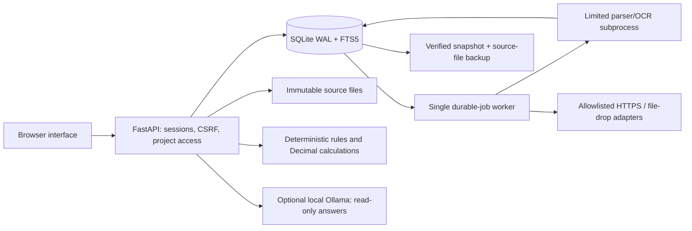

# Architecture

## Runtime and data flow

One Uvicorn process serves the static browser interface and API. An embedded thread processes durable jobs; document parsing/OCR runs in child processes. SQLite WAL supports readers and serialized writes. This is a single-host design, not a distributed queue or multi-tenant database service.

## Module map

| Module | Responsibility |
|---|---|
| `backend/main.py` | HTTP routes, middleware, bootstrap, workflow orchestration and static assets |
| `backend/security.py` | Passwords, sessions, CSRF, project roles and login throttling |
| `backend/models.py` | Strict Pydantic request models, dates, limits, component attributes |
| `backend/db.py` | Schema initialization/migrations, transactions, audit chain |
| `backend/documents.py` | Source validation, hashing, immutable storage, text/OCR, proposed fields, FTS |
| `backend/worker.py` | Persistent jobs, subprocess limits, retries and connector scheduling |
| `backend/engine.py` | Eligibility, demand, financials, qualifications, fingerprints, invalidation |
| `backend/programmes.py` | Consolidation plan overlap checks, deduplication and roll-ups |
| `backend/connectors.py` | File drop, field mappings, HTTPS restrictions, reviewed import, delivery |
| `backend/llm.py` | Project-scoped evidence prompting and citation validation/repair |
| `backend/sample.py` | Fictional documents generated through the normal ingestion pipeline |
| `web/` | Plain JavaScript/CSS UI; server-served, no separate build pipeline |
| `ops/backup.py` | Consistent SQLite snapshot plus referenced sources, verification, restore |
| `ops/manage.py` | Local operator account list and interactive password recovery |

## Trust and state boundaries

An uploaded document is untrusted evidence. It is stored with a UUID filename and SHA-256 hash, then extracted into page/sheet-linked chunks and proposed fields. Human review is required before catalog import and approval-related use. Source review, catalog state, qualification, decision approval, change delivery, implementation and actual benefits are separate states.

The LLM receives retrieved approved excerpts; it has no write/approval tools. Citation identifiers are checked and one corrective generation is allowed. Entailment and engineering validity still require human review. The retrieval method is lexical FTS5, not semantic embeddings.

The engine fingerprints relevant scope/inputs and preserves approval snapshots. Changes can invalidate pending decisions. Implemented decisions keep historical approved financials while current evaluation is separate. Plan readiness aggregates child state; it does not create a new engineering authorization.

## Storage and restart behavior

`AXIOM_DATA` contains `axiompack.sqlite3`, `uploads/`, `inbox/` and runtime directories. SQLite transactions enforce atomic imports and foreign-key relationships. On initialization interrupted running jobs are requeued. Webhook deliveries have durable identity and retries, but external delivery is at least once: receivers must honor idempotency keys.

Source paths and database snapshots must stay together. Copying only the live SQLite file is not a complete backup. Use the supplied backup tool. The audit chain verifies local continuity/hashes but can be reconstructed by a privileged database administrator.

## Scaling boundary

Use exactly one process/worker against one local database. Adding Uvicorn workers or sharing SQLite on a network filesystem is not a supported scaling strategy. A multi-host edition requires deliberate database migration, queue coordination, durable file storage, distributed rate limiting, operational observability and concurrency testing. The current service templates do not claim high availability.
